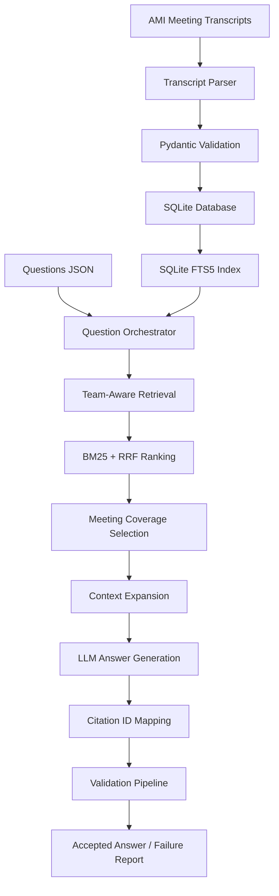

# Meeting Memory Agent

An evidence-grounded meeting memory system that retrieves information from meeting transcripts, generates concise answers using an LLM, and validates citations against the original speaker turns.

## 1. Project Overview

Meeting Memory Agent is a Python-based system designed to answer questions about historical meetings.

It processes meeting transcripts, stores structured meeting and speaker-turn data in SQLite, retrieves relevant evidence using full-text search, and generates answers with citations.

The system focuses on:
- Finding relevant information across multiple meetings.
- Tracking decisions and how they evolved.
- Preserving speaker attribution.
- Identifying commitments, numbers, and important details.
- Grounding generated answers in original transcript evidence.
- Validating citations before accepting an answer.

## 2. Problem Statement

Meeting transcripts contain valuable information, but retrieving a specific decision or detail across many meetings can be difficult.

A simple keyword search may find relevant words without understanding which meetings contain the strongest evidence or how a decision changed over time.

This project addresses that problem through a structured pipeline:

1. Parse transcripts into meetings and speaker turns.
2. Store structured data in SQLite.
3. Retrieve relevant evidence using SQLite FTS5.
4. Rank evidence using BM25 and Reciprocal Rank Fusion.
5. Expand retrieved evidence with nearby speaker turns.
6. Generate answers using an LLM.
7. Validate the answer structure and citations.

## 3. Key Features

- **Transcript ingestion:** Parses meeting metadata and speaker turns.
- **Structured storage:** Stores meetings and turns in SQLite.
- **Full-text search:** Uses SQLite FTS5 for transcript retrieval.
- **BM25 ranking:** Ranks relevant speaker turns.
- **Reciprocal Rank Fusion:** Combines results from multiple search queries.
- **Team-aware retrieval:** Restricts retrieval to the requested team.
- **Meeting coverage:** Prioritizes evidence from different meetings.
- **Context expansion:** Adds neighboring speaker turns to provide context.
- **LLM answer generation:** Uses a Groq-hosted model through the OpenAI-compatible SDK.
- **Citation mapping:** Maps model-selected citation IDs to original transcript quotes.
- **Citation validation:** Checks that citations belong to the correct team and occur within a single speaker turn.
- **Batch processing:** Processes multiple questions while isolating individual question failures.
- **Automated testing:** Includes pytest tests and Ruff code-quality checks.

## 4. System Architecture



### Question-answering flow

The orchestrator follows this sequence:

```text
retrieve_team_evidence()
        |
        v
Meeting coverage check
        |
        v
expand_evidence_context()
        |
        v
generate_answer()
        |
        v
validate_answer()
        |
        v
Accepted answer or failure
```

## 5. Technology Stack

| Technology | Purpose |
|---|---|
| Python 3.12+ | Main programming language |
| uv | Dependency and project management |
| Pydantic | Data and answer validation |
| SQLite | Structured persistent storage |
| SQLite FTS5 | Full-text transcript search |
| BM25 | Search-result ranking |
| Reciprocal Rank Fusion | Combining multiple search rankings |
| Groq | LLM inference |
| OpenAI Python SDK | OpenAI-compatible API client |
| python-dotenv | Environment-variable loading |
| pytest | Automated testing |
| Ruff | Linting and code quality |

## 6. Project Structure

```text
meeting-memory-agent/
│
├── data/
│   ├── transcripts/              # Meeting transcript files
│   ├── questions.json            # Questions to answer
│   └── CREDITS.txt               # Dataset attribution
│
├── outputs/
│   ├── batch_run_report.json     # Question-processing report
│   └── submission.json           # Final assignment submission
│
├── src/
│   └── meeting_memory_agent/
│       ├── agent/
│       │   └── orchestrator.py
│       │
│       ├── generation/
│       │   ├── client.py
│       │   ├── generator.py
│       │   └── prompts.py
│       │
│       ├── ingestion/
│       │   ├── batch.py
│       │   └── parser.py
│       │
│       ├── retrieval/
│       │   ├── context.py
│       │   └── search.py
│       │
│       ├── storage/
│       │   ├── batch.py
│       │   └── database.py
│       │
│       ├── validation/
│       │   ├── answers.py
│       │   ├── citations.py
│       │   └── pipeline.py
│       │
│       ├── models.py
│       ├── run_full_ingestion.py
│       └── run_questions.py
│
├── tests/
├── .env.example
├── .gitignore
├── .python-version
├── pyproject.toml
├── uv.lock
└── README.md
```

*Note: The tree illustrates the main application modules and expected project files. Local databases and temporary test artifacts may also exist but are not all shown.*

## 7. Data Model and Database Design

The system uses SQLite to persist meeting metadata and speaker turns.

### Meetings

A meeting record contains information such as:

- Meeting ID
- Team ID
- Meeting number
- Meeting label

### Speaker turns

Each speaker turn contains:

- Meeting ID
- Turn index
- Timestamp
- Speaker ID
- Transcript text

### Data integrity

Pydantic models validate incoming meeting data.

The implementation checks:
- Required meeting and speaker-turn fields.
- Valid speaker IDs (A–D).
- Valid timestamps in `HH:MM:SS` format.
- Chronological ordering of speaker turns.
- Non-empty meeting and turn content.

SQLite provides:
- Foreign-key relationships.
- Unique constraints.
- Indexes for commonly queried fields.
- Cascading deletion of associated speaker turns.
- Transactional persistence.

## 8. Retrieval Strategy

The retrieval layer uses SQLite FTS5 rather than a vector database.

### 8.1 SQLite FTS5

An FTS5 virtual table indexes speaker-turn text.

Search queries are tokenized, stop words are removed, and the remaining terms are used to search transcript content.

Database triggers keep the full-text index synchronized with speaker-turn inserts, updates, and deletes.

### 8.2 BM25 ranking

FTS5 uses BM25 ranking to order matching speaker turns.

Lower BM25 scores represent better matches in the implementation.

### 8.3 Reciprocal Rank Fusion

The system runs multiple retrieval queries and combines their ranked results using Reciprocal Rank Fusion.

The ranking contribution for a result is based on:

```text
RRF score = sum(1 / (k + rank))
```

The implementation uses `k = 60`.

This helps combine rankings without directly comparing raw BM25 scores from different searches.

### 8.4 Meeting coverage

The retrieval layer prioritizes evidence from different meetings.

It first selects strong candidates from distinct meetings, then fills remaining result slots while respecting the per-meeting limit.

This helps the answer-generation stage access evidence showing how decisions evolved across meetings.

## 9. Context Expansion

A relevant speaker turn may not contain enough information by itself.

For example, one speaker may ask a question and another speaker may provide the answer in the next turn.

The context-expansion module retrieves neighboring turns around selected evidence.

The original retrieved evidence remains distinguishable from the additional context.

This gives the generation stage more conversational context without losing the original citation source.

## 10. LLM Generation and Citation Mapping

The generation layer uses a Groq-hosted model through the OpenAI-compatible Python SDK.

The prompt instructs the model to:

- Answer using the supplied evidence.
- Keep answers between one and three sentences.
- Select citation IDs from the provided candidates.
- Use evidence from multiple meetings.
- Avoid inventing citations or transcript quotations.

### Deterministic citation mapping

The model selects citation IDs such as `C001` and `C002`.

The application then maps those IDs back to the original transcript evidence.

The final citation quote is taken from the original candidate rather than being trusted as newly generated model text.

The generator checks candidate membership, duplicate selections, quote length, and distinct meeting coverage.

Generation allows up to two attempts.

## 11. Validation Pipeline

The validation pipeline has three main stages.

### Stage 1: Schema validation

Pydantic validates the answer structure.

The answer must contain:
- A valid question ID.
- A non-empty answer.
- Between one and three sentences.
- Between one and three citations.

Unexpected fields are rejected.

### Stage 2: Question ID validation

The generated answer must correspond to the expected question ID.

### Stage 3: Citation validation

The citation validator checks:
- The cited meeting exists.
- The meeting belongs to the requested team.
- The quote contains at least six words.
- The normalized quote occurs within a single speaker turn.
- Citations are not duplicated.
- Evidence covers at least two distinct meetings.

The validator also identifies the speaker and turn associated with the matched evidence.

**Validation limitation:** These checks establish that citation text can be found in the correct team's transcript. They do not independently prove that the cited text semantically supports the generated answer. Human review is still important for factual accuracy and interpretation.

## 12. Installation and Environment Setup

### Requirements

- Python 3.12 or later
- uv
- A Groq API key
- Meeting transcript data
- Internet connection for LLM inference

### Clone the repository

```powershell
git clone <YOUR_REPOSITORY_URL>
cd meeting-memory-agent
```

### Install dependencies

```powershell
uv sync --extra dev
```

### Configure environment variables

Create a `.env` file in the project root:

```env
GROQ_API_KEY=your_groq_api_key
GROQ_MODEL=openai/gpt-oss-20b
```

Never commit `.env` or expose API keys.

The `.gitignore` file excludes `.env` and local database files.

## 13. Running Transcript Ingestion

Run the ingestion script from the project root:

```powershell
uv run python run_full_ingestion.py
```

The ingestion pipeline:

1. Reads transcript files from `data/transcripts/`.
2. Parses meeting metadata and speaker turns.
3. Validates the parsed data.
4. Stores meeting and turn records in SQLite.
5. Verifies the resulting record counts.

**Important:** The full-ingestion script deletes the existing database file before rebuilding it. Back up any database you need to preserve before running this command.

## 14. Running Question Answering

Run the complete question batch:

```powershell
uv run python run_questions.py
```

Run a specific question:

```powershell
uv run python run_questions.py --question-id Q01
```

The runner also supports retrieval-limit configuration:

```powershell
uv run python run_questions.py --limit 10
```

The batch runner uses the following defaults:

| Setting | Default |
|---|---:|
| Retrieval limit | 10 |
| Per-meeting limit | 3 |
| Context window | 1 |
| Minimum distinct meetings | 2 |

The batch runner processes questions sequentially and isolates individual question failures.

Its processing report is written to:

```text
outputs/batch_run_report.json
```

This report is not the final assignment submission file.

## 15. Testing and Code Quality

Run the automated test suite:

```powershell
uv run pytest -q
```

Run Ruff:

```powershell
uv run ruff check .
```

Compile the application source:

```powershell
uv run python -m compileall src
```

## 16. Submission Format and Results

The final assignment submission uses this structure:

```json
{
  "answers": [
    {
      "question_id": "Q01",
      "answer": "A concise evidence-grounded answer.",
      "citations": [
        {
          "meeting_id": "TEAM123a",
          "quote": "An original quotation from a speaker turn."
        },
        {
          "meeting_id": "TEAM123b",
          "quote": "Another original quotation from a speaker turn."
        }
      ]
    }
  ],
  "brief": "A plain-text meeting brief."
}
```

The final submission is stored at:

```text
outputs/submission.json
```

The question runner produces the batch report separately. Submission assembly and final file auditing are separate steps.

### Dataset processing results

The completed ingestion run processed:

| Metric | Result |
|---|---:|
| Meetings | 138 |
| Design teams | 35 |
| Speaker turns | 48,148 |
| Questions | 25 |
| Successful final answers | 25 |
| Failed final questions | 0 |
| Final citation audit errors | 0 |

The final citation audit confirmed that the checked citation quotes were present in the appropriate team's transcripts and covered at least two distinct meetings per answer.

These results describe the completed project run; they do not imply automated semantic verification of every answer.

## 17. Limitations and Future Improvements

Potential future improvements include:

- Semantic verification that cited evidence actually supports each answer.
- Automated answer-quality evaluation.
- Better handling of ambiguous questions and conflicting decisions.
- Hybrid retrieval combining full-text and embedding-based search.
- Retrieval and generation observability.
- Token-cost and latency monitoring.
- Improved retry and failure-recovery strategies.
- A user-facing interface for searching meeting history.
- More comprehensive end-to-end tests.

## 18. Dataset Attribution

This project uses the AMI Meeting Corpus.

The dataset is licensed under Creative Commons Attribution 4.0 International (CC BY 4.0).

Please retain the attribution and licensing information in:

```text
data/CREDITS.txt
```

The original dataset's authors and licensing terms must be credited when redistributing or using the dataset.